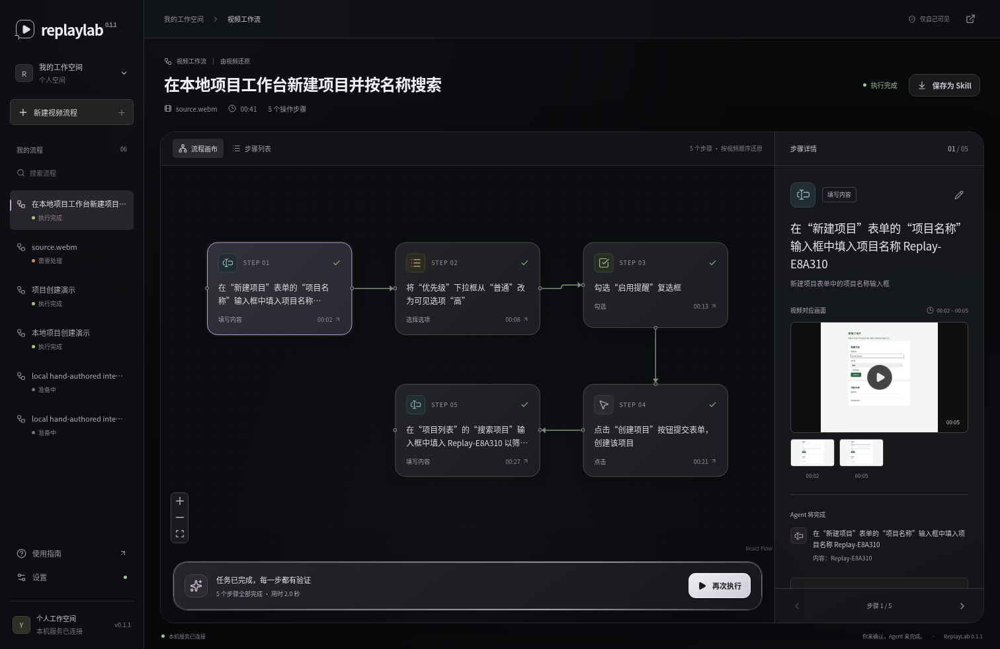

# ReplayLab 0.1.1

从操作视频恢复带证据的浏览器工作流，经人工审核和执行验证后导出 Agent Skill。

开发中。已实现本地视频 / 公开媒体链接 → FFmpeg 抽帧 → 视觉模型接口 → React Flow 编辑 → Playwright 执行 → Skill 导出的首轮代码。

**已完成一个真实视频的最小端到端验证**：DeepSeek 官方 `deepseek-flash` 从 41.08 秒可控网页录屏中恢复 5 步，人工确认待确认项后，在新浏览器会话执行并通过独立断言，导出 Skill 再次执行通过。操作步骤未人工改写；这不是任意网站或第三方视频的成功率证明。

本例获取、抽帧与工作流生成共 19.89 秒，首次回放 1.97 秒，Skill 重放 1.72 秒；不包含视频录制和人工审核时间。[实际输出、失败记录与复现方法](docs/validation/v0.1.1/README.md)。



黑色流程画布展示视频对应步骤，右侧查看画面证据；确认后交给 Agent 代操作，执行通过即可下载 Skill。截图使用本次真实模型生成并验证的流程，原视频的浅色画面保留原样。

工作台、示例页与弹窗统一深色玻璃材质，Agent 操作栏直接复用 MIT 开源的 [liquid-glass-react](https://github.com/rdev/liquid-glass-react)。[改版后的示例页](docs/assets/replaylab-demo.png)已用同一工作流和导出的 Skill 回放通过，未再次调用模型。

```bash
uv sync --extra dev --locked
source .venv/bin/activate
playwright install chromium ffmpeg
cd apps/web-workbench && npm ci && npm run build
cd ../..
replaylab serve
```

另需系统 `ffmpeg` / `ffprobe`。工作台默认地址为 `http://127.0.0.1:8765`，令牌位于 `.replaylab/token`。无模型演示和真实分析命令见快速开始。

完整安装、模型配置和演示见 [快速开始](docs/quickstart.md)。开发边界见 [实施状态](docs/status.md)。

- [开源依赖复用](docs/dependencies.md)
- [必要验证记录](docs/validation.md)
- [合并后审查修复与 API 版本约束](docs/review-fixes.md)
- [延期测试清单](docs/testing-backlog.md)

遵循 [Karpathy 开发约定](AGENTS.md)，仅做当前改动必要的验证；全面测试由项目所有者主动提出后开展。

MIT License。外部运行时与依赖遵循各自许可证。
